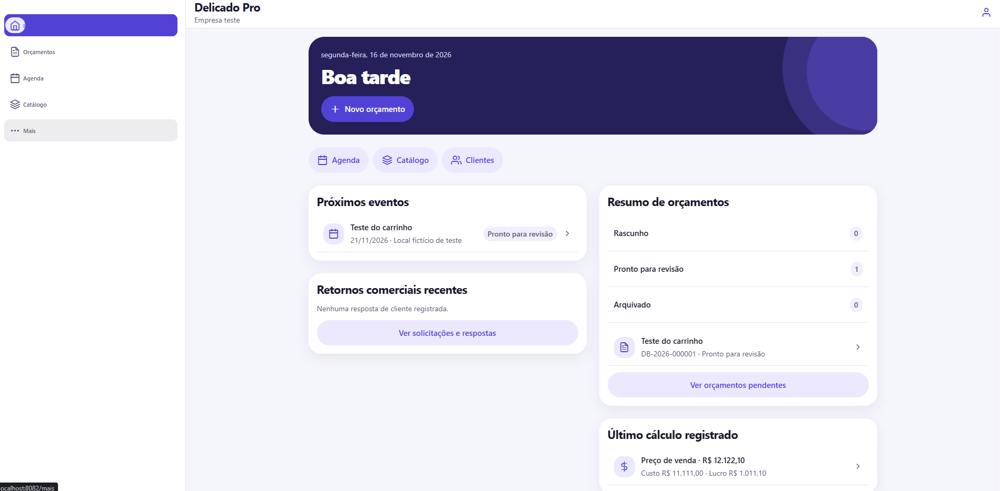

# Delicado Pro — Parecer para desenvolvimento

Revisão de 16 de novembro de 2026. O parecer cobre o site comercial, o aplicativo de gestão, a integração entre eles e a entrega Android.

## O que o produto faz

O **site** apresenta o trabalho de decoração e recebe pedidos de orçamento. O **aplicativo** organiza o catálogo, os clientes, a agenda, os cálculos, os orçamentos e as propostas da empresa. Ambos usam o Supabase, com autenticação e isolamento de dados por empresa.

### Site do cliente

| Página | Comportamento |
| --- | --- |
| Início | Vitrine com apresentação, imagens de referência para casamentos e comemorações e chamadas para solicitar orçamento. O link de uma categoria pode preencher o tipo de evento no formulário. |
| Orçamento | Login e cadastro com e-mail e senha. O cadastro reusa o Supabase Auth, com confirmação de e-mail quando exigida pelo projeto. Depois de entrar, o cliente informa nome, tipo de evento, data prevista, cidade, serviços e detalhes. |
| Catálogo | Busca por texto e filtro por Balões, Acervo ou Materiais complementares. Exibe os itens ativos da empresa vinculada ao portal, com imagem quando disponível. O cliente adiciona, remove ou ajusta quantidades e volta ao orçamento com a seleção. |
| Envio | Os dados do evento e a seleção são mantidos na aba durante a navegação. O site valida os campos, envia o pedido ao banco e só exibe **Solicitação recebida** após confirmação. A mensagem final é “A equipe vai analisar os detalhes e poderá entrar em contato”. |
| Proposta recebida | Página prevista para abrir um link individual emitido pelo app e mostrar condições, valor, referências e ações de resposta. A consulta real, o PDF e o retorno da decisão dependem da função `public-proposal` publicada e configurada. |

### Aplicativo da empresa

| Área | Comportamento |
| --- | --- |
| Início | Painel com empresa ativa, saudação, novo orçamento, atalhos, próximos eventos e resumo de orçamentos. As informações financeiras e os retornos comerciais aparecem conforme as permissões da conta. |
| Orçamentos | Busca e filtros por estado. O editor passa por cliente, evento e condições comerciais. Os estados são **Rascunho**, **Pronto para revisão** e **Arquivado**. O detalhe permite abrir a composição, as referências e a proposta conforme o papel. |
| Pedidos do site | Caixa de entrada para o proprietário. O detalhe mostra os dados e o e-mail do cliente, a cidade, a data, os serviços, os materiais e as quantidades. O responsável pode levar o pedido de **Nova** a **Em análise** e depois a **Encerrada**. |
| Agenda | Calendário baseado nas datas dos orçamentos ativos, com consulta por dia e acesso ao orçamento correspondente. |
| Catálogo | Cadastro e consulta de Balões, Acervo e Materiais complementares, com categorias e arquivamento conforme o vínculo. O carrinho interno permite selecionar produtos e quantidades para iniciar uma composição de orçamento. |
| Calculadora | Calcula custos, transporte, mão de obra, acréscimo, desconto, preço de venda, lucro e margem conforme as permissões. A composição é registrada no orçamento. |
| Clientes | Cadastro, busca, consulta de histórico e arquivamento. Acesso a dados e operações varia por papel. |
| Propostas comerciais | O app prepara uma versão de um orçamento pronto para revisão, com identidade comercial, histórico, link e opções de compartilhamento. As respostas retornam à área comercial quando a integração externa estiver configurada. |
| Mais e Minha conta | Acesso a Clientes e Minha conta, com consulta da sessão e opção de sair. O sistema diferencia proprietário, administrador e membro. |

## Como o pedido chega à equipe

1. O cliente solicita o orçamento no site, escolhe itens e envia.
2. O Supabase grava uma **solicitação comercial** em `website_requests`, com uma cópia dos itens e quantidades selecionados. O portal local está vinculado à **Empresa teste**.
3. No app atualizado, o proprietário da empresa abre **Orçamentos → Pedidos do site** e seleciona a solicitação. Também existe o caminho **Início → Ver solicitações e respostas → Pedidos do site**.
4. **Iniciar análise** atualiza o estado da solicitação. Os orçamentos elaborados pela empresa são registros próprios e aparecem na lista de Orçamentos. A conversão automática de um pedido do site em rascunho de orçamento está pendente.

A solicitação de casamento foi recebida em 16/11/2026 às 12h34, horário de Brasília, com cinco itens selecionados. O status **Nova** foi preservado para o responsável analisar.

## Como está o visual

### Site

- Cabeçalho branco com a marca e o menu superior **Início**, **Decoração**, **Catálogo** e **Orçamento**. Em telas estreitas, o menu continua no topo e pode quebrar linha.
- Página inicial com uma seção de destaque dividida entre texto em fundo violeta escuro e foto de decoração. Os cartões de casamentos e comemorações aparecem em duas colunas no desktop e empilhados no celular.
- Fundo lavanda muito claro, texto escuro, cartões brancos arredondados, sombras suaves e botões em violeta. A tipografia usa a fonte do sistema, com títulos em negrito.
- No catálogo, busca e filtro ficam acima da grade. As fotos têm quadros de proporção 4:3, com o produto inteiro e o botão **Adicionar** alinhado ao rodapé. A seleção fica à direita no desktop e abaixo dos produtos no celular.
- O orçamento usa cartões com campos arredondados e ações claras para entrar, criar conta, escolher materiais e enviar. A confirmação é exibida num cartão da mesma família visual.

### Aplicativo

- No Android e iOS, a navegação principal fica na barra inferior, com ícones e rótulos. A versão Expo Web usa menu lateral na largura de desktop.
- O painel tem destaque violeta escuro, atalhos em lavanda e cartões brancos para eventos, resumo de orçamentos, retornos comerciais e cálculo. Em telas largas, os cartões são distribuídos em colunas.
- As telas de gestão usam listas com ícones, chips para filtros, etiquetas de situação e formulários com títulos e ações visíveis. **Pedidos do site** usa o mesmo padrão da lista de Orçamentos.

A imagem acima é uma referência anterior da versão Expo Web. A barra lateral dessa captura corresponde ao desktop. O celular usa a barra inferior definida no código.

## Estado de integração e pontos para o desenvolvedor

| Ponto | Estado em 16/11/2026 |
| --- | --- |
| Pedido enviado pelo site | Registro confirmado no Supabase da Empresa teste. O novo atalho resolve o caminho até a caixa de entrada na versão atualizada do app. |
| Catálogo do portal | Vinculado à Empresa teste no Supabase. Os itens ilustrativos foram cadastrados com autorização para teste. As imagens geradas desses itens são arquivos locais vinculados aos cartões do site. Definir empresa e acervo finais antes da abertura a clientes. |
| Converter pedido em orçamento | O pedido recebido e o rascunho interno têm ciclos próprios. Uma futura conversão deve preservar a empresa, referenciar o pedido de origem e evitar rascunhos duplicados. |
| Enviar proposta ao cliente | O endereço público da página de proposta está ausente no ambiente do app. O endpoint configurado para a função devolveu HTTP 404. O fluxo de link, PDF e respostas reais ainda precisa ser ativado e validado. |
| Acesso externo ao site | A versão revisada é servida localmente na porta 8786. Para clientes fora do computador, publicar a versão comercial num endereço HTTPS e configurar autenticação e origem permitida. |
| Android e iOS | O código é React Native/Expo. O teste em aparelho físico depende de dispositivo conectado ou instalação pelo responsável. O iOS requer sua própria build assinada. |

As solicitações do site são visíveis ao proprietário ativo da empresa. O portal mostra somente os itens ativos vinculados e o banco aplica RLS para separar empresas. Os custos internos usados no app ficam fora da consulta do catálogo comercial.

## Onde alterar

| Área | Arquivos |
| --- | --- |
| Site e navegação | [public-proposal](../public-proposal/index.html), [estilos gerais](../public-proposal/site.css) e [estilos do catálogo](../public-proposal/catalogo.css) |
| Fluxo web de orçamento | [Formulário](../public-proposal/orcamento.html), [envio](../public-proposal/orcamento.js), [catálogo](../public-proposal/catalogo.js) e [sessão e seleção](../public-proposal/portal-session.js) |
| Aplicativo | [Navegação principal](../src/app/(principal)/_layout.tsx), [painel](../src/screens/Dashboard.tsx), [orçamentos](../src/quotes/QuotesScreen.tsx) e [pedidos do site](../src/websiteRequests/WebsiteRequestsScreen.tsx) |
| Aparência do app | [Tokens do sistema visual](../src/design-system/tokens.ts) |
| Banco | [Solicitações do site](../supabase/migrations/20261116000100_solicitacoes_site.sql) e [catálogo do site](../supabase/migrations/20261116000200_catalogo_site.sql) |
| Proposta externa | [Tela e emissão no app](../src/proposals/ProposalsScreen.tsx), [página da proposta](../public-proposal/proposta.html) e [função do Supabase](../supabase/functions/public-proposal/index.ts) |

Para abrir a versão local do site, execute `node public-proposal/serve.mjs` na raiz e acesse [porta 8786](http://127.0.0.1:8786/). Para a prévia web do aplicativo, use `npm start -- --web --localhost --port 8082` e abra [porta 8082](http://127.0.0.1:8082/). O dev precisa das variáveis públicas do próprio ambiente e de uma conta com o vínculo adequado.

## Verificações da entrega

- O TypeScript passou na checagem e os nove testes existentes de clientes e calculadora passaram. O ESLint dos quatro arquivos alterados registrou cinco avisos sobre dependências de hooks e sintaxe de tipos de array, sem erros.
- A página inicial foi conferida no navegador local em largura de celular. As rotas de catálogo, orçamento e proposta retornaram HTTP 200 no servidor local. A resposta da rota estática e a disponibilidade da função de proposta no Supabase são verificações distintas.
- Em uma transação de leitura, o Supabase retornou a solicitação de casamento com cinco itens sob a política de acesso do proprietário da empresa.
- A mudança de navegação está em [Orçamentos](../src/app/(principal)/orcamentos.tsx), na [lista de orçamentos](../src/quotes/QuotesScreen.tsx), na [rota comercial](../src/app/solicitacoes.tsx) e na [tela de pedidos](../src/websiteRequests/WebsiteRequestsScreen.tsx). A entrega usa as permissões já vigentes no banco.
- O Gradle gerou o [APK Android atualizado](../Delicado-Pro-Android-Atualizado.apk). Foram verificados o atalho dentro do pacote, o identificador `com.delicadopro.app` e o certificado, igual ao do APK anterior. O pacote inclui quatro arquiteturas e usa a chave de depuração do projeto. A instalação e a navegação autenticada em um aparelho ainda precisam ser conferidas.
